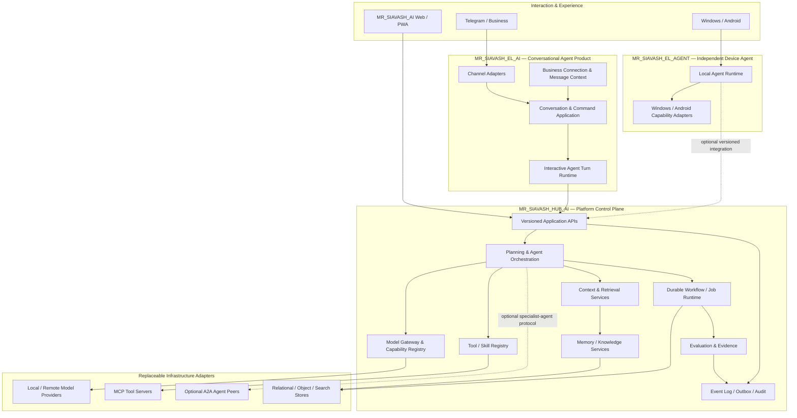

# PAIOS Target Architecture — 2027+ (v1)

**Status:** Proposed target architecture; implementation is not implied.  
**Decision owner:** MR_SIAVASH ecosystem owner.  
**Prepared:** 2026-11-26  
**Canonical home:** `MR_SIAVASH_HUB_AI`  
**Review horizon:** Reassess every 6 months, and whenever model/runtime capabilities materially change.

## 1. Purpose

This document defines the long-lived architecture for the four canonical MR_SIAVASH products:

1. `MR_SIAVASH_HUB_AI` — ecosystem control plane and shared platform services.
2. `MR_SIAVASH_EL_AI` — personal conversational agent and Telegram/Business experience.
3. `MR_SIAVASH_EL_AGENT` — independent Windows/Android device agent.
4. `MR_SIAVASH_AI` — public digital identity, website/PWA, learning experience and public gateway.

`MR_SIAVASH_EL_IR_BOT` is outside the current portfolio and execution scope. The ecosystem Telegram bot is owned and developed inside `MR_SIAVASH_EL_AI`; no separate legacy Bridge repository, transport service or migration dependency is assumed. See [ADR-0047](decisions/ADR-0047-four-product-ecosystem-scope-and-telegram-ownership.md).

The target is not a speculative 2030 stack. The target is an architecture that can replace models, agent harnesses, transports, storage engines, frameworks and deployment topology without replacing the whole ecosystem.

## 2. Evidence and current source baseline

This blueprint was prepared against these GitHub `main` snapshots observed on 2026-11-26:

| Repository | Observed main SHA | Existing architecture evidence |
|---|---|---|
| HUB | `f2943e4b68aa95051bba02a53aacf6b3de461521` | FastAPI modular monolith, agent planning/evaluation, jobs/workers, model providers, memory, tools/MCP, device contracts, API and integration contracts |
| EL_AI | `678d368b17cc6e2ccc8c99e3e96a3bad9e12e3eb` | Telegram-facing app, task-plan consumer, scoped Hub client, signed Bridge consumer, owner/public routing |
| EL_AGENT | `9d830ef05468db90da39cf8572f73192bec00e0b` | Standalone Windows/Android runtimes, local providers, device capabilities, scheduler and optional Hub adapters |
| Website | `e55d4a04dd9d59e54c8c1fa13ef864117fae6c4c` | Static Persian-first site/PWA, public Cloudflare Gateway, local workspace and public integrations |

This is a repository-source snapshot, not proof of local uncommitted changes, live Telegram behavior, current Cloudflare traffic, physical-device acceptance or production readiness. No local `SIA.env` values were inspected.

### Existing systems to reuse, not duplicate

- HUB already contains an agent orchestrator, model/provider registry and router, memory and knowledge modules, a durable job/worker engine, tool registry, MCP integration, device contracts, GPI/AWI planning and evidence-oriented evaluation. The first implementation task is a gap map against this blueprint, not a second implementation of those systems.
- EL_AI already has a Telegram-facing application boundary, a signed Bridge consumer and versioned Hub integration.
- EL_AGENT already has independent local execution and Windows/Android platform adapters.
- The Website already has a separate public Gateway and must remain a public product rather than a mirror of private Hub state.
- EL_AI owns the complete ecosystem Telegram bot boundary, including channel transport and user-facing behavior. Internal adapters/workers may be separated only when justified within the EL_AI product; no separate EL_IR_BOT dependency is assumed.

## 3. Architectural thesis

**A model is a replaceable reasoning component, not the whole agent.** A useful agent system is the composition of:

- a durable session and event history;
- a replaceable harness/runtime loop;
- a context-construction system;
- a planner and workflow executor;
- model/provider adapters;
- versioned tools and skills;
- observable external environments;
- objective evaluation and recovery;
- user-facing channel adapters.

The architecture deliberately separates the *brain* (model reasoning), the *hands* (tools and device actions), the *memory/state* (sessions and durable data), and the *operating system* (workflow, policy, identity and integration control).

## 4. Design principles

1. **Contract-first, implementation-second.** Public and cross-module interfaces are typed, versioned and compatibility-tested.
2. **Modular monolith before microservices.** Keep modules inside existing deployments until measured isolation, scale or independent release needs justify a service boundary.
3. **Replaceable harness.** Model loop, session store, context builder, tool dispatcher and execution environment have independent interfaces.
4. **Durable work.** Long-running tasks survive process restarts through persisted state, checkpoints, idempotency and explicit unknown-outcome handling.
5. **Context engineering.** Build a small, task-specific context view; do not dump all memories, messages or tool definitions into every model call.
6. **Capability-oriented tools.** Tools and skills have stable IDs, versions, typed inputs/outputs, declared dependencies and tests.
7. **Simple by default, agentic when justified.** Use deterministic workflows for fixed processes; use autonomous planning only when dynamic decisions improve measured outcomes.
8. **Evaluation before complexity.** Add extra model calls, subagents, vector retrieval or new infrastructure only when an evaluation suite demonstrates a gain.
9. **Provider independence.** OpenAI, Anthropic, local models and future providers implement replaceable adapters. Provider-specific SDKs must not leak into domain modules.
10. **Offline/local resilience.** Core user-facing functions degrade gracefully when a cloud provider or HUB connection is unavailable.
11. **Single ownership of state.** Each product owns its data; cross-product exchange uses versioned APIs/events, not shared database files.
12. **Evidence-based completion.** A model claiming success is not proof. Verify results through trusted application state, tests or external evidence.

## 5. Logical architecture

This is a responsibility map. It does not require every box to be a separately deployed service.

## 6. Product ownership and integration boundaries

| Product/component | Owns | Does not own |
|---|---|---|
| HUB | Cross-product task/workflow state, central planning and orchestration, canonical model/tool registries, shared private memory/knowledge, grants/approvals, evidence and audit | Telegram UI or device-specific platform implementation |
| EL_AI | Telegram and Business channel lifecycle, user-facing conversation, Telegram identity mapping, command interpretation, message/media normalization, channel session state and response delivery | A competing cross-product database, global permission authority or duplicate long-running workflow engine |
| EL_AGENT | Standalone device runtime, device-local state, local providers, scheduler and Windows/Android actions | Telegram Business lifecycle or HUB's canonical task database |
| Website | Public identity, public learning/workspace experience, public Gateway and public content | Private owner context, HUB credentials, private memory or local agent execution by implication |

### Cross-product communication

- Each product exposes a versioned contract and a stable service identity.
- No product imports another product's private implementation modules.
- No shared SQLite/D1 database file or cross-project table access.
- Use synchronous APIs for request/response operations and versioned events for asynchronous lifecycle updates.
- Use a transactional outbox where a database mutation must reliably publish an event.
- Every cross-product operation carries a trace/correlation ID, schema version and idempotency key where appropriate. Correlation IDs are diagnostic metadata, not credentials.
- Local HUB integration remains local-first. The Website public Gateway is never treated as a private HUB tunnel.

## 7. Agent runtime: the canonical execution cycle

The HUB runtime remains the canonical executor for durable, cross-product tasks. EL_AI owns the interactive conversational turn and delegates durable or privileged work to HUB. EL_AGENT owns device-local execution when used standalone.

A standard agent turn follows this lifecycle:

1. **Normalize request:** convert a channel update into a channel-neutral, typed request.
2. **Resolve actor and session:** identify the owner, business customer, public visitor or paired device; load only the relevant session state.
3. **Classify work:** answer directly, run a deterministic workflow, or create an agentic task.
4. **Build context:** assemble relevant instructions, recent events, approved memories, knowledge results, attachments and tool descriptions.
5. **Select a model:** choose by capability, user mode, task quality, latency, availability and declared cost; disclose route changes.
6. **Plan:** use a fixed plan for predictable tasks; ask the model for a structured plan for dynamic tasks.
7. **Execute:** invoke typed tools/capabilities and persist step transitions.
8. **Observe:** obtain actual tool/environment results; never infer success from a generated statement.
9. **Evaluate:** compare evidence with the goal and acceptance criteria.
10. **Recover or revise:** make bounded retries/replans only when state and idempotency make them safe.
11. **Deliver:** return a typed answer/artifact and persist the final status and references.

The runtime must support a direct-response path so simple conversation does not pay the latency and cost of an unnecessary multi-agent workflow.

### Core runtime interfaces

| Interface | Responsibility |
|---|---|
| `AgentRequest` | Typed user goal, actor, channel, input, attachment references, locale, constraints, deadline and budget |
| `SessionStore` | Durable append/read of session events, checkpoints and compacted views |
| `ContextBuilder` | Select and organize context for one model step |
| `ModelGateway` | Capability-based inference request and normalized response |
| `Planner` | Structured plan and dependency graph for tasks that need planning |
| `ToolDispatcher` | Resolve and invoke registered tool capabilities |
| `WorkflowRuntime` | Durable steps, retries, leases, cancellation and recovery |
| `Evaluator` | Compare actual evidence with acceptance criteria |
| `ArtifactStore` | Store and reference media, files and generated outputs |
| `TraceSink` | Correlate model, tool, workflow and channel events |

Provider SDKs and Telegram library types stay behind adapters.

## 8. Agent harness, sessions and context

Anthropic's Managed Agents work (2026-04-08) separates Session, Harness and Sandbox so each can evolve independently. We adopt the abstraction, not Anthropic's hosted implementation:

- **Session:** append-only event history and durable references, outside the model context window.
- **Harness:** the runtime loop that invokes models, supplies context, dispatches tools and controls iteration.
- **Execution environment:** a replaceable local or remote adapter for code/media/device tasks. No arbitrary execution is introduced by this document.

Context is a *view* over session events, memory and task state—not the canonical data store itself. The context builder can summarize, filter, retrieve or reconstruct a view without mutating the original event history.

Compaction must be loss-aware: preserve event references, decisions, pending steps, evidence and unresolved outcomes. A compacted summary is not a replacement for the original event log.

## 9. Model Gateway and provider strategy

The Model Gateway is capability-based, not a hard-coded provider chain.

Each provider adapter declares:
- provider and model identity/version;
- supported modalities and task capabilities;
- context/output limits where known;
- structured output/tool support;
- streaming/background support;
- latency/cost metadata where available;
- normalized error and retry semantics.

A request declares constraints such as `local_only`, `pinned_provider`, `remote_allowed`, modality, latency class and budget. A fallback is allowed only within the request's declared route class. Do not silently change a local-only request to a remote provider.

Legacy `ai_router.py` behavior (provider inventory, per-chat overrides, health, routing, statistics and provider calls) is preserved as migration input. Its public behavior and settings are mapped into the new Model Gateway before replacement; it is not discarded as obsolete simply because a new interface exists.

No decision in this blueprint requires one provider vendor or one model family. The internal model contract must remain usable with OpenAI, Anthropic, Ollama-compatible local runtimes and future providers.

## 10. Tools, skills, MCP and A2A

### Tools versus skills

- A **tool** is a typed operation that can produce an observable result or side effect.
- A **skill** packages reusable task guidance, workflows, related tools and evaluation examples.
- A **capability** is the declared ability/permission boundary that makes a tool or group of tools available in a context.

A skill may recommend tools; it does not grant execution authority by itself.

### MCP

MCP is an interoperability adapter for external tool/resource servers. The existing HUB Tool Registry remains the canonical internal registry and policy path. MCP tools must be discovered, normalized and dispatched through that path; do not build a second registry or let MCP bypass existing execution grants.

Pin an explicit stable MCP protocol revision per release. Draft extensions are optional and must not become mandatory application dependencies.

### A2A

A2A is an optional boundary for collaboration with independently operated agents. Do not use A2A for ordinary internal Python calls or every local skill. Adopt it when there is a real cross-agent interoperability need, a useful Agent Card, and task lifecycle/evidence semantics that justify the protocol.

### Multi-agent strategy

Start with one orchestrator and specialist capabilities. Delegate only when work is independently parallelizable, needs a separate specialist context, or measurably improves quality/latency. Prefer manager-as-tool for retaining final-answer ownership and handoff only when the specialist truly takes over. Set explicit turn, time, cost and task budgets.

## 11. Telegram and Business architecture

EL_AI owns the complete Telegram bot experience and implementation boundary: update intake, transport adapters, identity mapping, command routing, conversation, delivery state and user-facing responses. Internal workers or queue modules may exist inside EL_AI, but a separate Telegram Bridge repository or service is not assumed.

### Normalized update envelope

A Business message is normalized to a channel-neutral envelope containing:
- update/event identity and schema version;
- connection ID and connection status reference;
- business account identity;
- chat and message identity;
- message type and normalized text/caption;
- attachment references and media metadata;
- source timestamp and edit/delete information;
- reply capability metadata;
- trace and idempotency metadata.

Do not pass raw Telegram library objects into the Agent Runtime.

### Connection lifecycle

1. Receive `business_connection` update and persist the latest connection state.
2. Reconcile state using the official Telegram connection information when a connection is not cached or has been re-established.
3. Enable Business message handling only while the connection is enabled and supports the relevant reply operation.
4. Receive and normalize Business new/edit/delete message updates.
5. Process the message in an isolated Business conversation context.
6. Send a reply using the matching Business connection identity and supported reply method.
7. Stop the Business route when the connection is disabled, revoked or no longer reply-capable.

The lifecycle must be tested against Telegram's actual update contract; a normal `message` update is not a substitute for Business events.

### Unified command processing with distinct capabilities

Owner messages and Business-customer messages may enter the same *command interpretation and orchestration pipeline*, but they resolve to different actor contexts and capability sets:

- Owner context: personal commands and owner-authorized Hub capabilities.
- Business customer context: customer-facing business capabilities explicitly exposed by the owner.
- Business operator/admin context: only explicitly configured business-management capabilities.

This permits one shared command engine without accidentally treating a customer message as an owner instruction. Owner and Business/customer actor contexts remain strictly distinct regardless of channel.

### Media path

Incoming media is represented by an `AttachmentRef`, persisted or staged through the media adapter, then passed to OCR/transcription/vision/document processors as required. Outbound media is an artifact reference routed through the Telegram delivery adapter. The conversation engine should not contain Telegram-specific download or upload code.

EL_AI's actual Telegram ingress/update allowlist, delivery-state persistence and migration state must be checked before Business events are activated. Business support is a separate acceptance target; proposed architecture or mocked CI is not proof of live Telegram acceptance.

## 12. Memory, history and SQLite session lifecycle

Do not build a huge memory system first. Use progressive levels:

1. Current turn working context.
2. Channel conversation/session history.
3. Explicit user-approved stable preferences and facts.
4. Searchable episodic and semantic memory only when retrieval evaluations justify it.

Ownership:
- HUB: cross-product private task state, shared owner memory, knowledge and workflow evidence.
- EL_AI: Telegram conversation/session metadata, Business connection state, message mapping and channel delivery state.
- EL_AGENT: device-local memory and task state for standalone operation.
- Website: browser-local public workspace data and public Gateway records only.

Legacy SQLite data must be classified before cleanup:
- conversation/history records that can be exported to a documented portable format;
- temporary/cache data that can be regenerated;
- authentication/session material (for example Telethon session state), which is not ordinary conversation history and must not be included in a plaintext chat export.

Provide an export-preview, export, verification, and explicit deletion sequence. Retention policy must be defined per data class. No old database is deleted until exported data is validated and the required authentication re-link/recovery path is documented.

## 13. Persistence, events and workflow engine

Reuse HUB's existing database-backed job/worker/lease/recovery implementation first. Do not add Kafka, Redis, Kubernetes or Temporal merely for modern appearance.

- Keep relational state and schema migrations explicit.
- Use the transactional outbox pattern for reliable event publication.
- Keep an append-only execution event history with materialized current state for efficient queries.
- Use idempotency keys for externally visible writes where the remote API supports them.
- Model ambiguous external outcomes explicitly; do not blindly retry an operation that may already have succeeded.
- Keep large media in an artifact/object-store adapter, not inline in task rows.
- Introduce PostgreSQL when concurrent writers, multi-host deployment or operational constraints justify it.
- Introduce a workflow engine such as Temporal only if concrete requirements exceed the existing HUB runtime and a migration spike proves the benefit.

## 14. Retrieval and data stores

Start with the stores already available:
- relational database for authoritative state;
- full-text search for text retrieval;
- local file/object adapter for media and artifacts;
- optional embedding/vector index behind a Retrieval interface.

Add a vector database only when a benchmark demonstrates that it improves retrieval quality beyond lexical/full-text and metadata filtering for the actual project knowledge corpus. Keep source provenance and evidence references in every retrieval result.

## 15. Observability and evaluation

Every agent turn and durable task should expose a trace joining:
- incoming channel event;
- session and task identifiers;
- planning/model steps;
- tool calls and normalized outcomes;
- retries, handoffs and approvals;
- evaluation evidence;
- final delivery.

Use OpenTelemetry-compatible traces and metrics. GenAI input/output/tool attributes can contain sensitive material; the instrumentation must support allow-listed metadata and explicit content capture settings rather than recording full prompts by default.

Build a versioned evaluation corpus:
- direct conversational tasks;
- multi-step plans;
- tool-selection and argument correctness;
- context retrieval relevance;
- workflow resume/recovery;
- media input/output;
- Telegram Business lifecycle and reply behavior;
- feature-parity cases extracted from the legacy bot.

A model's self-rating is not an acceptance signal. Acceptance uses deterministic assertions, trusted tool evidence, human review where semantic judgment is required, and regression comparison across model/runtime versions.

## 16. Technology decisions and adoption gates

| Area | Direction | Adoption rule |
|---|---|---|
| Core language | Python for HUB and EL_AI; Kotlin/Java platform code for Android; JavaScript/TypeScript for Website/Workers | Keep current working language; do not rewrite a repository solely for language fashion |
| Python runtime | Compatibility matrix across 3.12–3.15; choose the newest version supported by all critical libraries and target environments | Python 3.15 is stable as of 2026-10-09, but do not force it onto legacy dependencies before clean-install, CI and runtime acceptance |
| API | Existing FastAPI/Pydantic contracts | Extend existing services, avoid a duplicate API framework |
| Telegram | Transport adapter behind normalized update/reply interfaces | Compare existing library, current Worker and a current Bot API library against Business events, media and async requirements before choosing |
| Agent SDK | Internal harness contract first; optional provider SDK adapter | OpenAI Agents SDK or another SDK may be used behind an adapter, not as the ecosystem's vendor lock-in |
| MCP | Supported external tools adapter | Pin protocol revision and route all calls through the existing Tool Registry |
| A2A | Optional external/independent-agent interoperability | Adopt only for cross-process/cross-vendor agent collaboration |
| Workflow | Existing HUB durable jobs/workflows | Replace only after an evidence-based technology spike |
| Database | Existing SQLite/local stores initially | Add PostgreSQL only for demonstrated concurrent/distributed need |
| Retrieval | Full-text + metadata first | Vector/hybrid search only after retrieval evaluation |
| Observability | OpenTelemetry-compatible tracing and metrics | Capture minimal useful metadata; version conventions and exporters |
| Frontend | Existing static/PWA foundation until IA/UX redesign | Redesign by product journeys and usability, not a framework migration |

### Python 3.15 decision

Official Python documentation states Python 3.15.0 was released on 2026-10-09 and lists 3.15 as the latest stable line at this review date. This is a reason to run compatibility tests—not a reason to migrate all projects immediately. The legacy bot currently has older Telegram and media dependencies, so the selected runtime is a compatibility outcome, not an assumption.

## 17. Designing for 2030 without guessing 2030

The architecture is considered future-ready when it can pass these *changeability tests*:

1. Replace a model provider without changing conversation, workflow or tool domain code.
2. Add a new channel adapter without changing the Agent Runtime.
3. Add or update a skill without changing the Tool Registry's core contract.
4. Replace the session storage backend while preserving the session event contract.
5. Add a new modality without embedding modality-specific logic in the conversation domain.
6. Move a workload from local to remote execution only through an explicit runtime adapter and declared data route.
7. Introduce an independent agent through A2A without coupling its internal implementation to HUB.
8. Upgrade a contract/schema with a documented compatibility window and migration test.
9. Re-run an old evaluation set against a new model, harness or prompt version.
10. Roll back a failed module/provider release without restoring unrelated products.

These tests matter more than choosing an imagined 2030 framework today.

## 18. Explicit non-goals

This architecture does not authorize:
- wholesale rewrite of all five repositories;
- automatic microservice decomposition;
- a new vector database, message broker or Kubernetes cluster without evidence;
- a multi-agent swarm for ordinary chat;
- automatic cloud fallback for a local-only request;
- arbitrary self-modification of production code;
- inspection, modification, migration, deployment or infrastructure changes in the out-of-scope `MR_SIAVASH_EL_IR_BOT` repository;
- production deployment, live Telegram webhook changes, D1 migrations or paid infrastructure.

## 19. Research basis

Reviewed 2026-11-26:

- OpenAI Agents SDK — agent, tools, sessions, handoffs and runtime options: https://openai.github.io/openai-agents-python/agents/
- OpenAI Agents SDK — tracing: https://openai.github.io/openai-agents-python/tracing/
- OpenAI Agents API — session/trace concepts: https://developers.openai.com/api/docs/guides/agents-api/tracing
- Anthropic, *Scaling Managed Agents: Decoupling the brain from the hands* (2026-04-08): https://www.anthropic.com/research/managed-agents
- Anthropic, *Effective context engineering for AI agents* (2025-09-29): https://www.anthropic.com/research/effective-context-engineering-for-ai-agents
- Anthropic, *Building effective AI agents*: https://www.anthropic.com/research/building-effective-agents
- Telegram, *Connected business bots*: https://core.telegram.org/api/bots/connected-business-bots
- Model Context Protocol specification: https://modelcontextprotocol.io/specification/
- Agent2Agent protocol specification: https://a2a-protocol.org/latest/specification/
- OpenTelemetry GenAI semantic conventions: https://opentelemetry.io/docs/specs/semconv/registry/attributes/gen-ai/
- Python 3.15 What's New: https://docs.python.org/3.15/whatsnew/3.15.html

This document records architectural conclusions drawn from public material; it does not claim that any vendor's internal production architecture is fully public or reproducible.

## 20. Owner-approved portfolio and logical-layer update — 2026-11-27

[ADR-0047](decisions/ADR-0047-four-product-ecosystem-scope-and-telegram-ownership.md) and [the G0–G12 governance baseline](../GOVERNANCE_PRODUCT_STRATEGY_G0_G12.md) supersede any conflicting portfolio or legacy-Bridge assumptions in this v1 document. The active products are HUB, EL_AI, EL_AGENT and MR_SIAVASH_AI. EL_IR_BOT is out of scope; the Telegram bot belongs inside EL_AI.

The current logical layer model is:

1. **Interaction & Experience:** Telegram, Web, Desktop, Android and API.
2. **Personal Agent — EL_AI:** identity, conversation, personalization and Telegram bot experience.
3. **Central Intelligence — HUB:** GPI, AWI, CGI, decisions, workflows and orchestration.
4. **AI Intelligence:** models, prompts, RAG, context construction and evaluation.
5. **Capability:** tools, skills, extensions and plugins.
6. **Data & Knowledge:** memory, knowledge, product data and events.
7. **Execution:** bounded workers, sandboxes and EL_AGENT device-local execution.
8. **Shared Infrastructure:** identity, data governance, APIs, observability, reliability and cost.

The **Independent Security Program** is an assurance overlay across every product and layer: security architecture, defensive cyber assurance, AI safety, threat modelling, audit and verification.

These are logical responsibility boundaries, not a one-to-one service topology. Prefer a modular monolith or a small number of deployables until measurable requirements justify service separation. Product ownership, state ownership and trust boundaries remain explicit even when multiple layers share one process.
