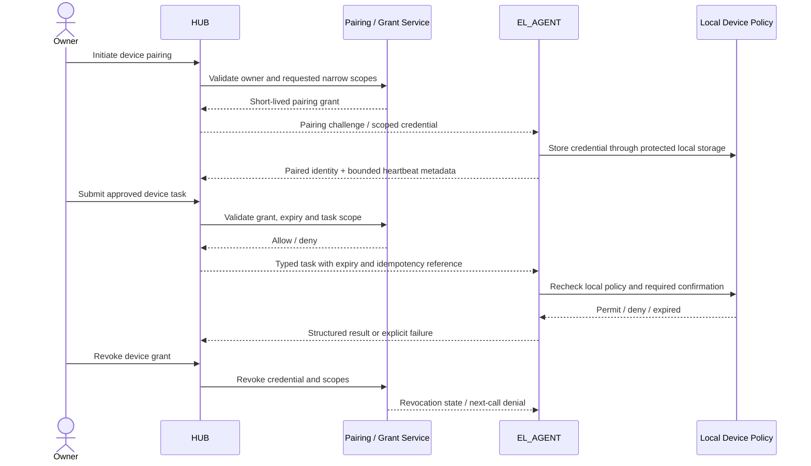
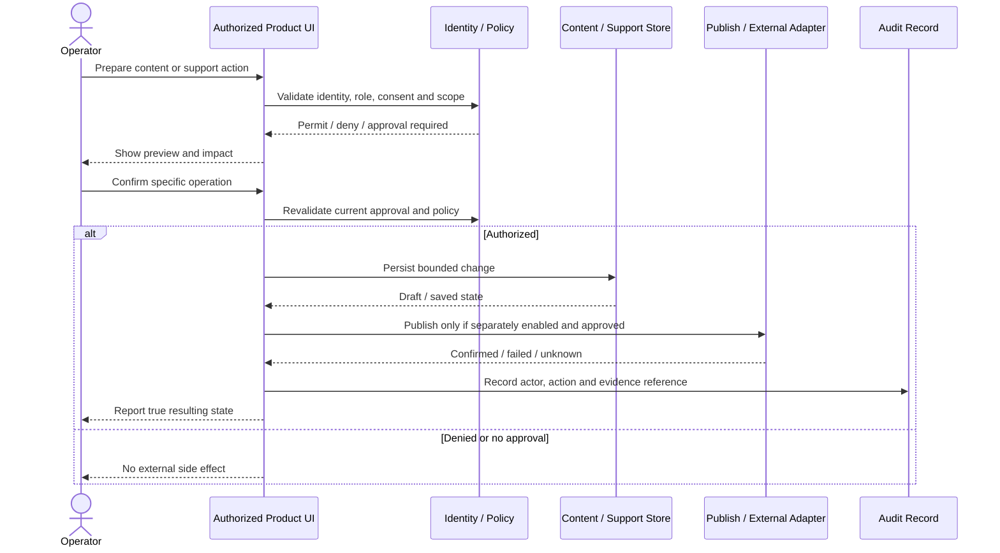

# Use-Case Sequence Diagrams — G3

- **Baseline:** 2026-11-27
- **Use-case source:** [USE_CASE_CATALOG.md](USE_CASE_CATALOG.md)
- **Requirements traceability:** [REQUIREMENT_USECASE_TRACEABILITY.md](../traceability/REQUIREMENT_USECASE_TRACEABILITY.md)
- **Portfolio authority:** [ADR-0051](decisions/ADR-0051-four-product-ecosystem-scope-and-telegram-ownership.md)
- **Status:** Logical sequence baseline; exact API operation names, message schemas and state diagrams must be reconciled with owning implementations before contract acceptance

These diagrams describe responsibility and trust boundaries, not an assertion that every arrow is currently implemented or enabled. A dashed arrow is an optional/conditional interaction. The owning product remains responsible for implementation and tests.

## UC-01 — Goal to Work Order preview

```mermaid
sequenceDiagram
    actor Owner
    participant EL as EL_AI
    participant HUB as HUB API
    participant WO as WorkOrder Service
    participant Policy as HUB Policy

    Owner->>EL: State goal and constraints
    EL->>EL: Resolve intent and actor context
    EL->>HUB: Submit bounded request + identity + request ID
    HUB->>Policy: Authorize request and allowed context
    Policy-->>HUB: Allow / deny / request clarification
    alt Allowed
        HUB->>WO: Create draft Work Order
        WO->>WO: Validate schema, scope, dependencies and criteria
        WO-->>HUB: Draft + revision + digest
        HUB-->>EL: Preview + assumptions + risks
        EL-->>Owner: Request review
        Owner->>EL: Accept, edit or reject preview
    else Denied or incomplete
        HUB-->>EL: Denial or clarification result
        EL-->>Owner: Explain safely; no execution
    end
```

**Safety invariant:** Planning a Work Order does not execute its steps. A consequential operation needs its own current authorization and approval.

## UC-02 — Durable workflow execution and evidence

```mermaid
sequenceDiagram
    actor Owner
    participant HUB as HUB Orchestrator
    participant Policy as Policy / Grants
    participant Queue as Durable Queue
    participant Worker
    participant Adapter as Capability Adapter
    participant Verify as Evidence Evaluator

    Owner->>HUB: Approve a specific WorkOrder revision
    HUB->>Policy: Revalidate actor, scope, grant and approval
    Policy-->>HUB: Allow or deny
    alt Authorized
        HUB->>Queue: Persist bounded job and idempotency key
        Queue-->>Worker: Lease eligible step
        Worker->>Policy: Recheck current grant and budget
        Policy-->>Worker: Permit / deny
        Worker->>Adapter: Execute typed bounded operation
        Adapter-->>Worker: Result or explicit unknown outcome
        Worker->>Queue: Persist attempt, checkpoint and result
        Queue-->>Verify: Trusted evidence reference
        Verify->>Verify: Check verifier trust, freshness and WorkOrder digest
        Verify-->>HUB: Accept / reject / review required
        HUB-->>Owner: Outcome with evidence and residual risks
    else Denied
        HUB-->>Owner: Denial; no job dispatch
    end
```

**Safety invariant:** Model output and worker self-report are not sufficient proof of completion. Revoked authority blocks subsequent steps.

## UC-03 — Owner Telegram conversation

```mermaid
sequenceDiagram
    actor Owner
    participant TG as Telegram
    participant Adapter as EL_AI Telegram Adapter
    participant Identity as EL_AI Actor Resolver
    participant Router as EL_AI Context Router
    participant HUB as Scoped HUB API

    Owner->>TG: Send message
    TG->>Adapter: Update
    Adapter->>Adapter: Validate envelope and deduplicate update
    Adapter->>Identity: Resolve bound Telegram identity
    Identity-->>Adapter: Owner / public / unknown
    Adapter->>Router: Pass bounded message and actor context
    alt Paired owner + private capability
        Router->>HUB: Scoped request with current credentials
        HUB-->>Router: Authorized bounded result
    else Public or unpaired actor
        Router->>Router: Use public-only route; never attach private HUB context
    end
    Router-->>Adapter: Bounded response
    Adapter->>TG: Send response
    alt Confirmed
        TG-->>Adapter: Acknowledgement
        Adapter->>Adapter: Record sent state
    else Ambiguous timeout
        Adapter->>Adapter: Record unknown state; do not claim delivered
    end
```

**Safety invariant:** Telegram username/text is not proof of owner identity. Public actors never receive owner-private context.

## UC-04 — Ambiguous Telegram delivery recovery

```mermaid
sequenceDiagram
    participant EL as EL_AI Delivery State
    participant TG as Telegram API
    participant Evidence as Supported Reconciliation Evidence
    participant Owner

    EL->>TG: Send with bounded request
    TG--xEL: Timeout / acknowledgement unavailable
    EL->>EL: Persist attempt as UNKNOWN
    EL->>Evidence: Query only supported message/update evidence
    alt Trusted evidence confirms delivery
        Evidence-->>EL: Confirmed
        EL->>EL: Mark SENT with evidence
    else Contract proves retry is safe
        Evidence-->>EL: Not delivered + safe idempotent retry allowed
        EL->>TG: Bounded retry
    else Outcome remains ambiguous
        Evidence-->>EL: Unresolved
        EL-->>Owner: Surface UNKNOWN; no blind replay
    end
```

**Safety invariant:** A transport timeout is not proof of non-delivery. Do not blindly replay an ambiguous non-idempotent send.

## UC-05 — Approved local device action

```mermaid
sequenceDiagram
    actor Owner
    participant Planner as EL_AGENT Planner
    participant Validator as Typed Schema Validator
    participant Policy as Local Policy
    participant Confirm as Owner Confirmation
    participant Adapter as Allowlisted Device Adapter
    participant State as Local State / Audit

    Owner->>Planner: Request bounded local task
    Planner-->>Validator: Typed proposal (untrusted)
    Validator->>Policy: Validated action + resource bounds
    Policy->>Policy: Check allowlist, grant, target and timeout
    alt Sensitive action requires confirmation
        Policy->>Confirm: Request explicit confirmation
        Confirm-->>Policy: Confirm / reject / expired
    end
    alt Permitted and confirmed
        Policy-->>Adapter: Scoped one-action grant
        Adapter-->>State: Observed result or unknown outcome
        State-->>Owner: Record actual result
    else Invalid, denied or unconfirmed
        Policy-->>Owner: Reject; no adapter invocation
    end
```

**Safety invariant:** Planner/model output cannot widen local permissions or bypass deterministic policy.

## UC-07 — Optional HUB / EL_AGENT pairing and revocation



**Safety invariant:** HUB authorization cannot override stricter local device policy; EL_AGENT remains independently usable when HUB is unavailable.

## UC-08 — Public Website assistant

```mermaid
sequenceDiagram
    actor Visitor
    participant Web as MR_SIAVASH_AI Browser
    participant Gateway as Public Gateway
    participant Source as Approved Public Sources

    Visitor->>Web: Submit question
    Web->>Web: Show disclosure and obtain required consent
    alt Consent granted
        Web->>Gateway: Current question + permitted public context only
        Gateway->>Gateway: Validate method, headers, size and rate limit
        Gateway->>Source: Retrieve approved public information
        Source-->>Gateway: Public evidence
        Gateway-->>Web: Bounded answer and validated references
        Web-->>Visitor: Render answer
    else Consent absent or private context requested
        Web->>Web: Use local/public-only fallback
        Web-->>Visitor: Explain limitation; do not forward private data
    end
```

**Safety invariant:** Browser code never receives HUB credentials or private owner memory. Public Gateway is not a proxy into private HUB routes.

## UC-10 — Content, support and admin operation



**Safety invariant:** Drafting content is not publishing it; spend, publication, data disclosure and production mutations keep independent owner-approval gates.

## 3. Implementation reconciliation checklist

For each diagram, the owning product must record:

- Actual API/adapter names, schema/version and source paths.
- Current actor and scope validation points.
- State transitions and idempotency/unknown-outcome behavior.
- Negative tests for denial, expiry, revocation, malformed data and timeout.
- Exact implementation SHA and test-run URL.
- Any deviation from the logical sequence, with an ADR or explicit rationale.

Do not use this logical diagram as proof that an integration, Telegram bot, cloud service or device path is live.
