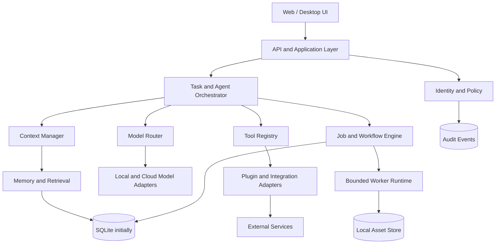

# System Architecture

## 1. Architectural decision

Build a **local-first modular monolith** with explicit internal contracts. Do not begin with microservices. The initial deployment is one backend process plus an optional worker process and a web UI. Modules may be split into services only when measured scale, isolation, or deployment needs justify it.

## 2. Logical architecture

## 3. Runtime planes

- **Control plane:** API, authentication, policy evaluation, configuration, registry, task lifecycle.
- **Execution plane:** bounded workers, model calls, approved tools, media processing, scheduled workflows.
- **Data plane:** relational metadata, memory documents, vector indexes when justified, generated assets, audit records.
- **Presentation plane:** web UI and later desktop shell. UI never receives provider secrets.

## 4. Core request lifecycle

1. Authenticate the caller and resolve the active workspace.
2. Validate request size, type, and rate limits.
3. Build a task specification and classify its risk.
4. Resolve context under workspace and data-source boundaries.
5. Select a model/provider under capability, privacy, availability, and cost constraints.
6. If tools are required, authorize each tool invocation independently.
7. Execute short work inline or enqueue bounded long-running work.
8. Persist task state and structured audit events.
9. Return a typed result or job handle.
10. Apply retention policy and expose cancellation/recovery controls.

## 5. Canonical shared services

- Identity and Workspace
- Policy and Permission Engine
- Task Orchestrator
- Model Router
- Context Manager
- Memory and Retrieval
- Tool Registry
- Job Scheduler and Worker Runtime
- Event and Audit Service
- Asset Store
- Health and Diagnostics

Specialist modules must consume these shared services rather than implementing competing copies.

## 6. Deployment

### Initial local mode
- Windows 11 development workstation.
- Python backend and worker.
- SQLite database.
- Local filesystem asset storage under an application data directory.
- Web UI served locally.
- No public network listener by default.

### Hybrid mode
- Explicit provider adapters for remote inference and integrations.
- Per-provider secrets stored outside source control.
- Outbound requests pass through policy and timeout controls.
- Local mode remains usable when remote providers are unavailable.

### Future deployment
Docker Compose may be added after the local baseline is stable. PostgreSQL is introduced only when concurrent access, operational needs, or deployment topology justify it.

## 7. Architectural constraints

- No arbitrary shell execution from agent output.
- No dynamic installation of dependencies at runtime.
- No unrestricted network access for tools.
- No direct imports across specialist module internals; use contracts.
- No secrets in frontend bundles, logs, prompts, or repository files.
- All background work has time, memory, concurrency, and retry bounds.
- Every external side effect has an idempotency strategy where feasible.
- Every data store has a documented owner, retention policy, and backup strategy.

## 8. Initial technology direction

| Concern | Initial choice | Rationale |
|---|---|---|
| Backend | Python + FastAPI | AI ecosystem and typed HTTP API |
| Frontend | React + TypeScript | Broad ecosystem and maintainability |
| Contracts | Pydantic schemas + OpenAPI | Runtime validation and generated API docs |
| Database | SQLite | Low operational overhead for single-user local use |
| Search | SQLite FTS5 first | Avoid premature vector infrastructure |
| Queue | Database-backed jobs first | No separate broker in the first milestone |
| Media | FFmpeg adapter, optional | Mature media pipeline; invoked with strict argument validation |
| Tests | pytest + API integration tests | Fast feedback and automation |
| Packaging | Python venv initially | Keep initial install inspectable and simple |

The technology choices are provisional until the first vertical slice is measured on the target laptop.

## 9. Architecture decision records

Material decisions must be recorded in `docs/architecture/decisions/` with context, alternatives, decision, consequences, and review triggers.
