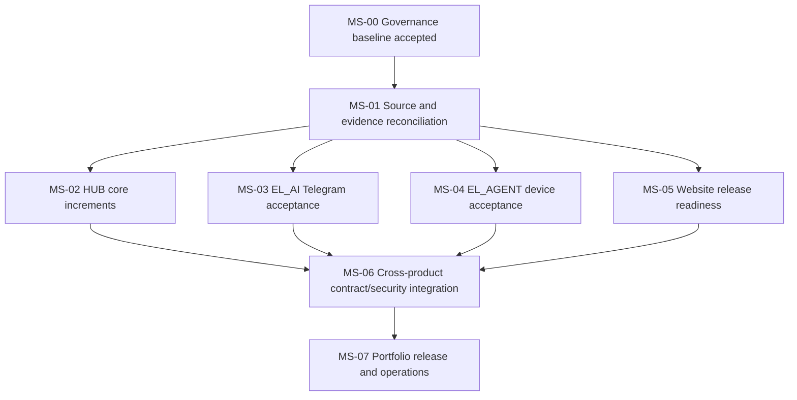

# Portfolio Milestone Register — G11

- **Baseline:** 2026-11-27
- **Portfolio authority:** [ADR-0051](../architecture/decisions/ADR-0051-four-product-ecosystem-scope-and-telegram-ownership.md)
- **Delivery controls:** [Delivery Management Standard](DELIVERY_MANAGEMENT_STANDARD.md)
- **Work Order schema/register:** [Template](WORK_ORDER_TEMPLATE.md) · [Governance Work Orders](ECOSYSTEM_WORK_ORDERS.md)
- **Technical roadmap:** [Four-product phase inventory](../roadmap/FOUR_PRODUCT_TECHNICAL_PHASES.md)
- **Status:** Initial milestone baseline; no target dates are committed until the ecosystem owner approves sequencing/capacity

## 1. Milestone model

A milestone is an outcome and exit gate, not a calendar promise. It can contain Work Orders from more than one repository, but each Work Order retains one accountable implementation owner.

- Milestones have stable IDs and explicit entry/exit conditions.
- Candidate dates remain **UNSCHEDULED** until the owner approves priority/capacity and any external dependency.
- Parallel work is permitted only where changed paths, product ownership and contract versions do not conflict.
- A milestone does not become accepted because its PRs were opened or merged; all exit criteria need evidence.
- Live Telegram, physical devices, cloud control planes, legal decisions and paid infrastructure remain separate owner/environment gates.

## 2. Portfolio milestone register

| Milestone ID | Outcome | Scope / linked work | Status | Entry / dependency | Exit criteria |
|---|---|---|---|---|---|
| MS-00 | Canonical four-product portfolio and governance baseline | ADR-0051; G0–G12 baseline; G9/G11/G12 artifacts; PR #639 | ACCEPTED — 2026-11-27 | Owner-defined four-product scope | ADR-0051 and governance baseline merged to HUB main; EL_AI/EL_AGENT/Website entry points aligned; no implied completion of all G0–G12 owner gates |
| MS-01 | Repository, requirement and engineering evidence reconciled | WO-GOV-003/004/010/011; G6/G7 baselines; G2/G3 traceability; PR #644 | IN_PROGRESS | MS-00; current source heads from all four repositories | Exact default-branch SHAs recorded; all workflows classified; requirements linked to implementation paths/test IDs; sequence diagrams reconciled with actual contracts; stale historical evidence clearly labeled |
| MS-02 | HUB planning, evidence and operator core increment | H10 merged PRs #640/#641 with workflow-step verifier/correction extension PR #652; memory lifecycle PR #648 (H9/H16 support); operator memory lifecycle UI PR #653 (H17 slice); prompt-template registry PR #651 (cross-cutting planning/agent foundation; exact phase mapping remains under review); H1–H20 dependencies | IN_PROGRESS | MS-00; identity, API and workflow foundations H0/H7/H8/H11/H12/H16 | Exact-head CI, verifier-negative tests and consumer contracts pass; WorkOrder digest/revision semantics, prompt registry compatibility and memory lifecycle retention behavior are reviewed; separate H14 provider-routing, H17 operator-console, H18 performance and H19 release-governance exits remain evidenced independently |
| MS-03 | EL_AI personal-agent and Telegram end-to-end path | E1–E10/E13/E14; local inbound-reply outbox PR #149; FR-ELAI-01…07; UC-03/04 | IN_PROGRESS — owner/environment gate | HUB scoped API contract; test-bot identity and isolated configuration | Telegram update intake and delivery state machine pass duplicate updates, confirmed-chunk resume, changed-response quarantine, interrupted/unknown send and no-replay tests; rate-limit/expiry/media/background-notification coverage is separately evidenced; controlled test-bot round trip is evidenced; operator runbook and secret/revocation process accepted |
| MS-04 | EL_AGENT independent Windows/Android acceptance | D0–D14; FR-AGENT-01…07; UC-05/06/07 | IN_PROGRESS — device gate | Stable local policy, packaging and device matrix; optional HUB pairing must not be a core dependency | Offline/local core acceptance with network/HUB disabled; Windows and supported Android physical-device install/permission/session/recovery checks; package provenance, rollback and support runbook |
| MS-05 | Public Website quality and release readiness | A0–A14; FR-WEB-01…06; UC-08/09/10 | IN_PROGRESS — release gate | Public/private boundary and static/Gateway build contracts | Responsive/RTL/accessibility and browser acceptance; public Gateway negative isolation tests; data/consent/retention acceptance; current Preview/Production/D1 readback and backup/rollback approval before production mutation |
| MS-06 | Cross-product contract and security integration | X1–X10; FR-X-01…04; NFR-SEC/PRIV/REL/OBS | PLANNED — dependency gated | Producer/consumer schemas and identity owners from MS-02…MS-05 | Producer and consumer contract suites pass on exact SHAs; identity/scope/revocation, idempotency, timeout, error envelope, correlation and public/private boundaries verified across all enabled integrations |
| MS-07 | Portfolio release and operating readiness | H19, E14, D14, A14, X10; G11/G12; WO-GOV-002/008 | OWNER GATE | MS-01…MS-06 accepted; named release operators and authorized environments | Required branch rules verified; operational owners/runbooks/alerts/backup restore/incident/rollback accepted; legal/privacy and provider-cost decisions recorded; only then authorize release candidates |

## 3. Current evidence checkpoint — 2026-11-27

This checkpoint records source and exact-head CI state observed on 2026-11-27. PR labels and branch names are not phase acceptance. This is not a production, provider, Telegram, or physical-device readback. The HUB main head is `06b31147d47886c9ad2c87c3130983931808ef69`; separate default-branch checks were also performed for EL_AI, EL_AGENT and Website.

### HUB

- **main at this checkpoint:** `06b31147d47886c9ad2c87c3130983931808ef69`.
- **PR #639:** merged as `3fbe372922c9e3885917bcaf3b1157889ed862b2`; portfolio authority and G0–G12 baseline integrated.
- **PR #641:** merged as `4f684b8a8494ffe263db6769b312f884cd6df311`; owner-scoped read-only H10 evidence API slice.
- **PR #644:** merged as `2e911058f6f23fc2b2dbc193d63479314daebecb`; G0–G12/H10 phase evidence reconciliation.
- **PR #648:** merged; adds bounded memory lifecycle stages and retained-only Dreaming behavior. This is a memory/data-lifecycle slice supporting H9/H16; it does **not** complete roadmap H17 (operator/control center).
- **PR #653:** merged as `6059ac71021e7e0fa78e8cf7cd8d910def0c71e4`; adds an owner-reviewed Operator UI slice for memory lifecycle controls. It does not complete H17.
- **PR #652:** merged as `06b31147d47886c9ad2c87c3130983931808ef69`; extends the existing H10 plan/evidence path with atomic one-to-one WorkOrder-plan/Workflow binding, a trusted workflow-step verifier, and read-only correction proposals. It also integrates the versioned Prompt Registry foundation. This is a scoped H10/H14/H18/H19 increment, not completion of those phases; E8 consumer integration and broader evidence/replanning acceptance remain open.
- **PR #651:** closed as superseded by #652; no parallel Prompt Registry implementation remains open.
- **PR #654:** open draft on current main; scoped H20–H22 slice for frozen/versioned specialist profiles, metadata-only registry discovery, bounded sequential handoff, and explicit preservation of conflicting specialist assessments. Exact-head checks on `e3c95d39d667c42da9dd93738f2c78b21c254c39` are in progress; no phase is marked complete.
- **PR #655:** open draft on current main; H15 increment to the existing FTS5 knowledge search using bounded owner-declared metadata reranking. Exact-head checks on `b1006c94bc1698a8ddced37ce8c03fb7048990f2` are in progress. This remains lexical retrieval, not semantic/vector hybrid RAG.
- **PR #656:** open draft; H16/H17 memory-retention increment with bounded owner-scoped expiry cleanup, read-only retrieval/preview, and explicit purge. Exact-head checks on `f5af4079f2fc723535c791e3ccecd9f3d54fec9d` are in progress after two test corrections; no acceptance is claimed yet.
- **PR #650:** this G10/G11 documentation refresh; its checkpoint will be revalidated against the latest source and exact-head CI before merge. PR #647 is the superseded stale G10/G11 draft. PRs #637 and #636 remain separate workstreams. PR #618 remains a paid Render proposal and must not be provisioned without explicit billing/auto-sync authorization.

### EL_AI, EL_AGENT and Website

- Default-branch heads last checked for this checkpoint: EL_AI `368cbdf808f9bde672edee4f8fef6ad3fe8e8577`; EL_AGENT `d98aaff9593b7ffac996e0841c1232bae1dee4df`; Website `2a37c00d06b34a29c78c8b6b3aa9da3f0dd6d00a`.
- EL_AI PR #149 remains an inbound-reply local-polling delivery-outbox slice. It does not satisfy full E10 acceptance: background task/plan notifications, the legacy Bridge path, full media/rate-limit coverage and a controlled live test-bot round trip remain separate gates. No live test-bot operation is claimed.
- EL_AGENT D2 has a merged local token-file hardening slice, but physical Windows/Android acceptance and the D14 release gate remain open; no physical-device operation is claimed.
- Website A14 remains dependent on fresh live Preview/Production/D1 evidence and authorized release/rollback review; no deployment or live environment mutation is claimed.

## 4. Dependency graph and execution sequence

MS-02 through MS-05 may proceed in parallel only when their product ownership and changed files do not overlap. MS-06 depends on the stable contracts and acceptance evidence of each participating provider/consumer. MS-07 remains blocked until all applicable owner/environment gates are met.

## 5. Release candidate control

For each product release candidate, record:

- Release ID, version, environment and audience.
- Exact source SHA(s), artifact digest(s), dependency and contract versions.
- Included and excluded Work Orders and known issues.
- Exact-head test/check results and independent review.
- Security/privacy, migration, backup/restore and rollback evidence where applicable.
- Named release operator and explicit owner decisions for paid, production, public publishing, Telegram and physical-device operations.
- Post-release smoke/health evidence on the exact deployed version.

Never interpret a successful CI workflow as proof that a deployed service, Telegram bot, Android app, Windows installer, remote database or production traffic is healthy.

## 6. G11 milestone acceptance

A milestone may be closed only when:

1. Its outcome and exit criteria are met for the exact included source revisions.
2. Linked Work Orders are ACCEPTED; release milestones additionally require RELEASED evidence.
3. Applicable G9 P0/P1 risks are mitigated or explicitly accepted by the authorized owner.
4. Cross-product consumers verify the exact supported provider contract versions.
5. External/account/device/legal/cost gates have written owner evidence.
6. Residual risks, deferred capabilities and next milestone dependencies are recorded.

No calendar dates, percentage-complete claims or release commitments are created by this register.
