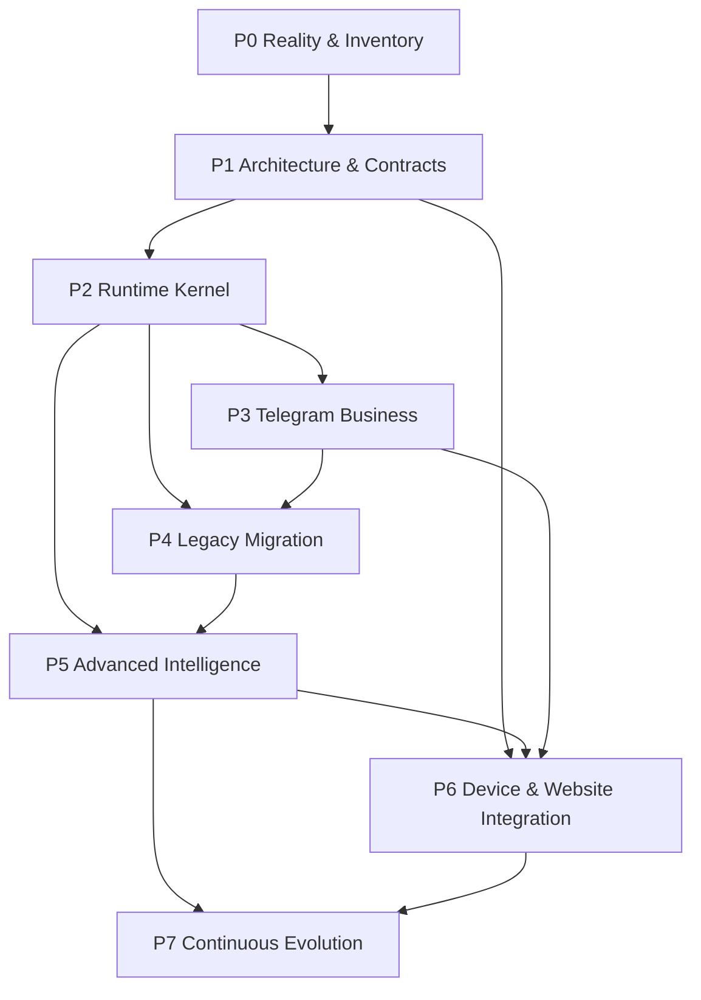

# PAIOS Execution Roadmap — 2026–2030

**Status:** Proposed execution baseline derived from `PAIOS_TARGET_ARCHITECTURE_2027.md`.  

> **Historical scope notice — 2026-11-27:** This roadmap predates [ADR-0047](../architecture/decisions/ADR-0047-four-product-ecosystem-scope-and-telegram-ownership.md). Its EL_IR_BOT migration source, separate Telegram Bridge, and related tasks are superseded for active work. Do not execute B0–B11 or legacy-Bridge migration from this document. The active portfolio is HUB, EL_AI, EL_AGENT and MR_SIAVASH_AI; Telegram bot work belongs inside EL_AI. Use [G0–G12 governance](../GOVERNANCE_PRODUCT_STRATEGY_G0_G12.md) as the current prerequisite baseline while a revised four-product technical phase inventory is prepared.
**Prepared:** 2026-11-26  
**Rule:** A phase is not complete because code exists or a PR is open. Completion requires its acceptance evidence and the required mainline integration.

## 1. Portfolio scope

Canonical products:
- `MR_SIAVASH_HUB_AI`
- `MR_SIAVASH_EL_AI`
- `MR_SIAVASH_EL_AGENT`
- `MR_SIAVASH_AI`

Migration source:
- `MR_SIAVASH_EL_IR_BOT` — preserve and migrate required legacy capabilities; keep a Telegram edge/queue component only while its transport value is demonstrated.

`Gshop` and `MR_SIAVASH_IR_H_BOT` are outside this roadmap.

## 2. Execution strategy

The work is dependency-driven, with one primary active implementation stream. Parallel work is allowed only on isolated deliverables that do not edit the same files or depend on unstable contracts.

Priority:
1. Make current state and product boundaries trustworthy.
2. Specify stable contracts and the replaceable runtime.
3. Deliver Telegram Business as the first visible vertical slice.
4. Preserve and migrate legacy capabilities.
5. Improve agent intelligence only on top of measured runtime foundations.
6. Integrate device and public website experiences.
7. Establish continuous evolution and repeatable release evidence.

## 3. Phases and acceptance gates

### P0 — Repository Reality & Capability Inventory

**Owners:** HUB coordination; each repository owner supplies source evidence.  
**Scope:** All four products plus legacy EL_IR_BOT source.

Work:
- Refresh each main SHA, branch/PR state, workflow state and dependency manifests.
- Inspect current entry points and actual runtime paths.
- Build a feature inventory for `MR_SIAVASH_EL_IR_BOT.py`, `self_core.py`, `ai_router.py`, EL_AI and current HUB modules.
- Record the behavior of every protected feature with a test, fixture or manual acceptance procedure.
- Map existing capabilities to target modules; mark missing, duplicated and unverified capabilities.
- Reconcile the older 73-phase roadmap with this product taxonomy; keep historical evidence, but use this baseline for future work once accepted.

Deliverables:
- `AS_IS_ARCHITECTURE.md`
- `FEATURE_INVENTORY.md`
- `LEGACY_MIGRATION_MATRIX.md`
- a current source/CI snapshot

Acceptance:
- No protected legacy feature is unclassified.
- Every product has one documented owner for its core responsibilities.
- Unknown runtime/deployment facts are labelled unknown, not guessed.

### P1 — Architecture & Contract Baseline

**Owners:** HUB architecture; EL_AI, EL_AGENT and Website provide consumer requirements.

Work:
- Accept the target architecture and ADR.
- Define canonical schemas for AgentRequest, ActorContext, SessionEvent, Plan, Task, ToolCall, CapabilityManifest, AttachmentRef, ArtifactRef and ExecutionResult.
- Define contract versioning, compatibility window, error model, idempotency and correlation semantics.
- Define service ownership and persistence boundaries.
- Add schema fixtures and consumer-driven contract tests.
- Create architecture fitness tests for provider/channel/store substitution.

Deliverables:
- target architecture and ADRs;
- versioned JSON/OpenAPI schemas;
- contract compatibility matrix;
- dependency and migration graph.

Acceptance:
- Contracts validate in every owning repository.
- No cross-product shared database or internal-module imports are required.
- A sample consumer can reject an unsupported contract version clearly.

### P2 — Runtime Kernel Gap Closure

**Owner:** HUB, with EL_AI as first consumer.

This phase extends the existing HUB platform; it is not a rewrite.

Work:
- Audit existing Agent Orchestrator, Model Router, Tool Registry, jobs/workers, memory, audit and evaluation against PAIOS contracts.
- Reuse working modules; write only missing adapters or contract migrations.
- Formalize SessionStore, ContextBuilder, ModelGateway and AgentHarness ports.
- Persist session/task event transitions and checkpoints.
- Add bounded run budgets, cancellation and normalized execution results where absent.
- Add trace correlation across interactive turn, Hub task and external delivery.
- Build a vertical-slice reference implementation using one local provider and one deterministic tool.

Acceptance:
- A sample task survives process restart and resumes from a valid checkpoint.
- Model/provider replacement passes the same contract tests.
- Tool result and final task state are independently verifiable.
- Existing H0–H10 capabilities are not duplicated or silently regressed.

### P3 — Telegram Business Vertical Slice

**Owners:** EL_AI application; EL_IR_BOT edge adapter during transition; HUB for durable task/tool services.

This is the first user-facing priority after the required contracts are stable.

Work:
- Extend update ingestion to Business connection lifecycle and Business message/edit/delete events.
- Persist and reconcile connection state and available reply capabilities.
- Normalize text, captions and media into a channel-neutral input envelope.
- Route Business customer conversations through the same conversation/command interpretation engine as other channels, but resolve a Business-scoped actor and capability set.
- Connect the conversation turn to the Model Gateway.
- Support generated text and media replies through the matching Business connection.
- Provide clear connected/disconnected/permission-missing state.
- Keep the owner command path distinct from customer-visible business capabilities.
- Add duplicate, retry and ambiguous-delivery handling using the existing edge/Hub mechanisms.

Acceptance:
- Real connection enable/disable updates change the route state correctly.
- Text, image, audio, video and document test cases are normalized and routed.
- Business customer messages reach AI and receive replies with the correct connection identity.
- Owner-only commands are not accidentally executed from customer conversations.
- Disconnect, revoked reply permission and stale connection states are handled correctly.
- Telegram live acceptance is explicitly recorded; mocked CI alone does not count.

### P4 — Legacy Capability Preservation & Migration

**Owners:** EL_AI and legacy EL_IR_BOT; HUB supplies shared service interfaces.

Protected files:
- `MR_SIAVASH_EL_IR_BOT.py`
- `self_core.py`
- `ai_router.py`

Work:
- Build tests/fixtures for current behavior before changing implementation.
- Extract cohesive modules while preserving public command/feature behavior.
- Preserve `self_core.py` custom capabilities; do not impose new feature restrictions as part of this migration.
- Map `ai_router.py` provider definitions, priorities, overrides, health checks, statistics and configuration semantics into the new gateway.
- Merge dependencies from `requirementss.txt` into the canonical dependency manifest after runtime usage and version compatibility are verified.
- Retire `bot.py` and `bot_server.py` only after import/call/deployment dependency analysis proves no required feature relies on them; prefer a reversible deactivation before deletion.
- Separate Telegram authentication session data from conversation history and temporary state.
- Provide export preview, export, integrity verification and deletion for eligible old SQLite history/session data. Do not delete authentication/session material until a re-link/recovery path is verified.

Acceptance:
- Feature-parity regression suite passes.
- The primary entry point is unambiguous.
- Clean installs work on the supported Python matrix.
- Every retired file has a replacement map and no unresolved references.
- Old data is either migrated, exported and verified, or explicitly retained with a documented reason.

### P5 — Advanced Agent Intelligence

**Owner:** HUB runtime; EL_AI consumes interactive capabilities; EL_AGENT implements independent local equivalents as appropriate.

Work:
- Dynamic task decomposition and plan revision.
- Context retrieval and context compaction with loss-aware checkpoints.
- Optional specialist agents and orchestrator-worker patterns.
- Evaluator/optimizer loops for tasks with measurable criteria.
- Versioned skills and capability discovery.
- Multimodal task routing and artifact workflows.
- Selective episodic/semantic memory and later memory consolidation.
- Model-assisted research and code workflows with verifiable tool evidence.

Acceptance:
- A benchmark suite shows measurable improvement over P2/P3 baselines on quality or completion rate.
- Added model calls and delegation remain inside declared latency/cost budgets.
- No multi-agent component is retained without an evaluated benefit.
- Long-running tasks can resume and produce evidence-linked outcomes.

### P6 — Device & Public Experience Integration

**Owners:** EL_AGENT for device runtime; Website for public UX; HUB for shared contracts.

Work:
- Connect EL_AGENT through versioned capability/device contracts while preserving standalone operation.
- Add optional Hub task relay and status synchronization.
- Redesign MR_SIAVASH_AI from information architecture and user journeys, not by patching the current theme.
- Build a coherent assistant entry point and public product experience.
- Keep public Gateway and private Hub boundaries explicit.
- Add browser/device acceptance across mobile and desktop.

Acceptance:
- EL_AGENT still works when Hub is unavailable.
- Website has its own clear public UX and never presents public GitHub metadata as private runtime health.
- Public/private state and capabilities are visibly distinguished.
- Responsive, accessibility and physical-device acceptance evidence is recorded.

### P7 — Continuous Evolution & 2030 Readiness

**Owner:** HUB governance; all products publish version/capability metadata.

Work:
- Version models, harnesses, prompts/context templates, skills, tools and schemas independently.
- Run compatibility and architecture fitness tests on upgrades.
- Add staged release, rollback and data migration evidence.
- Add an Evolution Engine that detects capability gaps, proposes changes, creates isolated test work and reports results.
- Evaluate new model families, protocols and workflow technologies on a fixed benchmark suite.
- Review the architecture every six months or after a major platform shift.

Acceptance:
- A new model/provider, channel or skill can be added without changing unrelated product modules.
- A breaking contract change has a tested migration path.
- A failed release can be rolled back without restoring unrelated projects.
- Evolution proposals cannot mark themselves as accepted; acceptance depends on test/evidence and release policy.

## 4. Dependency graph

P3 and selected P4 inventory/test work may overlap after P1 contracts are stable, but implementation must not create competing edits to the protected legacy files.

## 5. Execution roles

### Owner
- Defines product outcomes and performs account/device acceptance where access is not available to CI.
- Supplies local-only configuration on their machine; secrets are never needed in chat.
- Decides on irreversible data deletion, public/production release and paid infrastructure.
- Does not need to write technical Work Orders.

### Primary engineering agent
- Owns architecture, source inspection, implementation, testing, documentation, PR follow-through and mainline verification.
- Maintains one active high-impact implementation stream.
- Uses exact base SHAs and disjoint file scopes for parallel work.
- Does not describe a PR as complete until the required mainline and acceptance conditions are met.

### Specialist agents
- Receive isolated Work Orders with exact repository, base SHA, allowed paths, forbidden paths, tests and evidence.
- May research, design or implement independent modules.
- Must not edit protected legacy files or overlap another agent's file scope without coordination.

## 6. Work Order template

Every implementation assignment must include:

- Repository and exact base SHA
- Phase and objective
- Allowed files/paths
- Forbidden changes and protected feature list
- Dependencies/contracts
- Required behavior and acceptance criteria
- Required automated and manual tests
- Evidence links/output
- Rollback strategy
- Definition of complete

## 7. Status and completion semantics

Use exactly these states:
- `PLANNED` — scoped but not implemented.
- `IN_PROGRESS` — active implementation.
- `IMPLEMENTED` — code or documentation exists.
- `VERIFIED` — required automated tests and applicable acceptance checks pass.
- `MERGED` — accepted changes are on the target `main` branch.
- `RELEASED` — live deployment/device activation has been verified.
- `BLOCKED` — a specific dependency, permission or external condition prevents progress.

The word **complete** is reserved for the phase's required final state. A merged source change is not a production release. A green CI run is not a live Telegram or physical-device test.

## 8. Work that requires a separate explicit release decision

- Production deployment and webhook registration/changes.
- Live database migrations or irreversible data deletion.
- Paid hosted infrastructure or recurring charges.
- Sending real production messages or publishing public content.
- Any action that changes account permissions, credentials or external access.

The architecture and phase decisions do not authorize these operations.

## 9. Initial active queue

1. P0: refresh and complete the feature/behavior inventory (especially the three protected legacy files).
2. P1: turn this blueprint into concrete versioned contracts and architecture fitness tests.
3. P2: gap-close existing HUB/EL_AI runtime rather than duplicating it.
4. P3: deliver the Telegram Business vertical slice.
5. P4: feature-preserving migration and old SQLite data lifecycle.
